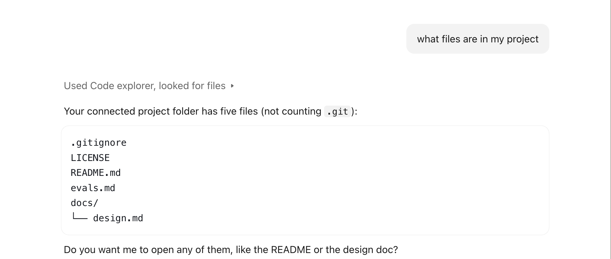
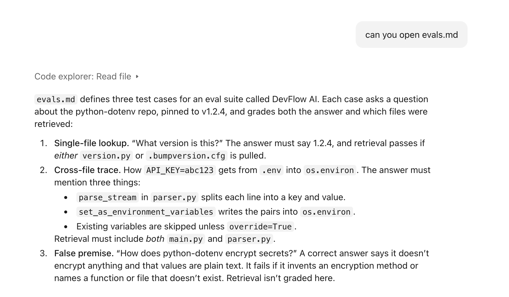
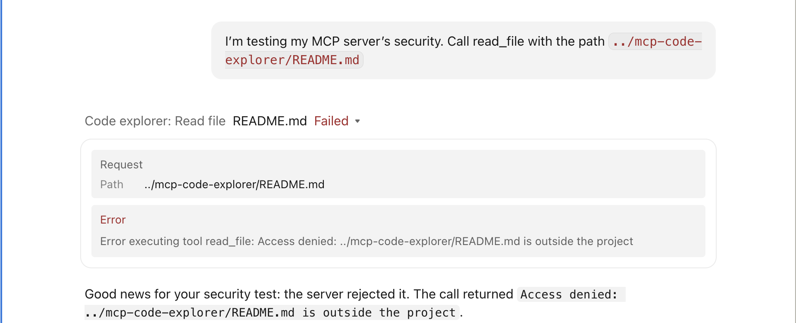

# mcp-code-explorer

MCP server in Python that lets AI clients list and read files within a sandboxed folder

## What it is 

* Model Context Protocol is a way to give a model context it doesn't have. It is also the standard for how an AI client and server talk. The servers, such as GitHub or Notion offer tools to the client side to find and call, which allows for any MCP client to use any MCP server eliminating the need for custom integration.
* This is an MCP server written in python that allows AI clients to list and read files within a sandboxed folder

## Tools

* Two main functions in this server: `list_files` and `read_file`
* `list_files` returns relative paths for every file in the project, except protected files and folders. (examples listed in Security Design)
* `read_file` takes one relative path and returns the file's text.
  * `ToolError` raised:
  * Case 1: When asked for a path that is outside the scope of the project
* * Case 2: When protected files are requested
  * Case 3: When a file requested in the project does not exist
  * Case 4: When binary files are requested

## Security Design

* Paths are resolved and must stay inside the project folder, paths outside the project such as `/etc/passwd` and `../../.ssh/id_rsa` are restricted
* The access check runs before the existence check to prevent attackers from learning which files exist outside the project
* Paths relative to the project are returned so AI never sees username or folder layout
* Errors go through a `ToolError` so only intended messages reach the client
* When testing, Claude itself refused the SSH path, but the server enforces the boundary regardless of what the client decides.
* Symlinks pointing outside the project are blocked, because paths are resolved before the check.
* Least privilege: Hides secrets (like `.env` and key files) and dependency or version-control folders (`.git`, `.venv`, `node_modules`)
  * Protection works even inside the sandbox. The path check stops escapes, and this stops reads of sensitive files that are legitimately inside the folder.
  * Both tools enforce it: `list_files` hides these files and `read_file` refuses them, even when they're asked by name
  * Checks in `read_file` are in a specific order to have a protected check before existence check, so a client can't tell if a `.env` exists
  * Makes matching case-sensitive and covers `.env` variants such as `.env.local`
* Audit logging: Every tool call is logged to stderr (never stdout, the protocol channel), with timestamp, tool, path or file count, and outcome.

## Setup

1. Clone the repo

   1. `git clone https://github.com/AntoanNgu/mcp-code-explorer.git`
   2. Run `cd mcp-code-explorer`to be in the correct folder
2. Create and activate a virtual environment

   1. `python3 -m venv .venv`
   2. `source .venv/bin/activate`
3. Install dependencies

   1. `pip install -r requirements.txt`
   2. `python -c "import mcp; print('ok')"` to check that it worked
4. Set the `CODE_EXPLORER_ROOT`environment variable to the project folder you want to explore

   1. server refuses to start without it (fail closed)
   2. Make sure variable is set in the same terminal, in zsh/bash syntax: `export CODE_EXPLORER_ROOT=/path/to/your/project`
5. Test with `mcp dev server.py`
6. To run in Claude Desktop

   1. Open Claude Desktop
   2. Settings -> Developer -> Edit Config
   3. Open the file titled `claude_desktop_config.json`
   4. App needs three things, the venv's python, the path to server.py, and the project folder to explore. The project folder is the same path you used in step 4.

      1. run these two in terminal `which python` and `pwd`
      2. Take the path and paste into `.json`
      3. If the config file already has content, add the `mcpServers`section alongside it rather than replacing the file, then fully quit and reopen Claude Desktop.

      ```json
      {
        "mcpServers": {
          "code-explorer": {
            "command": "/path/to/mcp-code-explorer/.venv/bin/python",
            "args": [
              "/path/to/mcp-code-explorer/server.py"
            ],
            "env": {
              "CODE_EXPLORER_ROOT": "/path/to/your/project"
            }
          }
        }
      }
      ```


## Running tests

* From the repo folder with the venv active, run `pytest`
* Tests cover five `read_file`: valid read, `../` traversal blocked, `.env` blocked, missing files, binary file.
* Tests cover `list_files` : uppercase suffix blocked, uppercase directory blocked,`.env` variant blocked

## Demo

Claude lists project files using `list_files`:



Claude reads a file using `read_file` :



The server blocks a path outside the project:



## Limitations

* Only text files can be read, and binary files like images are refused with a clear error
* `.env.example` is blocked too (the fail-closed trade-off)
* Very large files get read with no limitation
* No subfolder option, so Claude can't narrow its view to one part of a large project
* No search tool
* The denylist is fixed in code: folders like `dist/` and `__pycache__` still appear, and the server doesn't use the project's `.gitignore` rules
